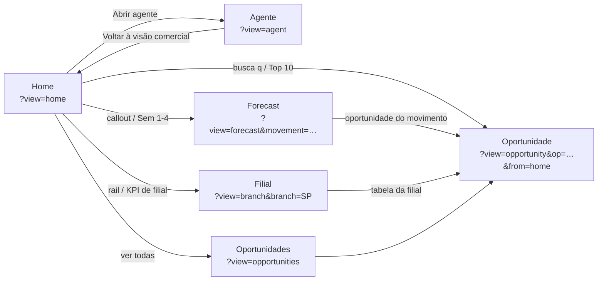

# Implementação V3 — Relato

**Data:** 2026-09-29 · **App:** `Dash com IA` · **Escopo:** Visão Comercial V3, que passa a ocupar a raiz `/` (o legado permanece no repositório, mas deixa de ser importado).

**Como ler este relato.** Três fases produziram o código: Fundação (agente principal, antes do workflow), Home e Drill (fases do workflow). O relator não escreveu código de produto: inspecionou a árvore e **re-executou** os gates para registrar exit code próprio. Onde a fase declarou um resultado que o relator não reproduziu, isso está dito explicitamente.

## 1. O que foi implementado, por tela

**Fundação (fase 1)** — `types.ts`, `context.ts`, `copy.ts`, `mock-data.ts`, `model.ts`: contrato de `CommercialView`/`CommercialContext` lido da query string, copy centralizada e modelo determinístico que reconcilia KPIs, movimentos e composição de receita. Declarado na fase: context 9/9, model 17/17, tsc 0, eslint 0.

**Home (`view=home`)** — as duas dobras. Shell com sidebar e header dirigidos por URL; hero do Agente com copy §18 + briefing-mini + callout da semana + grade Sem 1-4; 5 KPIs na ordem contratada; linha analítica (Evolução do mês, Movimentos do forecast, New Names × Cross); Top 10 de 12 colunas ordenado por `abs(deltaForecast)`; rail de Filiais + Destaques. `src/app/page.tsx` ficou com 16 linhas, só composição + `Suspense`.

**Agente (`view=agent`)** — briefing e conversa do agente reusando o mesmo modelo da Home (teste `briefing do agente reusa o mesmo modelo da Home`, verde na re-execução).

**Forecast (`view=forecast`)** — resumo, lista de movimentos e lista de oportunidades do movimento.

**Filiais (`view=branch`)** — tiles por filial, resumo e tabela de oportunidades da filial.

**Oportunidades (`view=opportunities`)** e **Oportunidade (`view=opportunity&op=…`)** — lista e detalhe em tela cheia, sem Sheet, com resumo, receita e timeline.

**Navegação e filtros** — view, período, solução, filial, `from`, `op` e `movement` vivem na URL; sidebar com `aria-disabled` apenas em Contas, Relatórios e Explorar; `view-pending.tsx` foi apagado quando todas as views ganharam tela real (confirmado: o arquivo não existe mais na árvore). A raiz `CommercialV3App` só roteia e injeta o mesmo snapshot por seletores puros (commercial-v3-app.tsx:147-209).

## 2. Arquivos

**Criados** — 43 arquivos, 4.914 linhas em `src/features/comercial-v3`: 10 na raiz (`agent.ts`, `commercial-v3-app.tsx`, `context.ts`, `copy.ts`, `format.ts`, `mock-data.ts`, `model.ts`, `nav.ts`, `opportunity-details.ts`, `types.ts`), 27 em `components/`, 6 em `screens/`. Mais 7 testes novos em `tests/comercial-v3-*.test.mjs`, 1.099 linhas.

**Alterados** — `src/app/page.tsx` (raiz passa a compor só `CommercialV3App`); `src/app/globals.css` (+ keyframe `drill-enter`, 220 ms, globals.css:200-204; a `message-enter` de 160 ms foi preservada em globals.css:188 porque o legado `src/components/central/agente.tsx` depende dela); `components/top-opportunities-table.tsx` ganhou a prop opcional `hrefDe`, com default que preserva o comportamento da Home; `types.ts` ganhou `opportunities` em `COMMERCIAL_VIEWS` e `movement` em `CommercialContext`; `selectOpportunityModel` ganhou 3º parâmetro opcional (default `'month'`) e `selectBranchModel` passou a aceitar `Omit<CommercialFilters,'branch'>`.

**Não tocados** — `src/features/comercial-v3/mock-data.ts` (congelado), `src/components/central`, `src/components/revenue-home`, `src/lib/revenue-home`, `src/app/api`. Nenhuma dependência nova.

## 3. Gates — o exit code é a verdade

| Comando | Exit | Executado por | Resultado observado |
|---|---|---|---|
| `node --test` nos 7 arquivos `tests/comercial-v3-*.test.mjs` | **0** | relator, agora | `tests 61 / pass 61 / fail 0` (Node v24.21.0) |
| `npx tsc --noEmit` | **0** | relator, agora | sem saída |
| `npx eslint src tests` | **0** | relator, agora | nenhum problema |
| `npx eslint .` (é o que `npm run lint` roda) | **1** | relator, agora | 3 erros em `scripts/capture-v3-qa.mjs` (`@typescript-eslint/no-require-imports`) + 32 warnings em `.zcode/workflow-runs/*.mjs`. **Nenhum** problema em `src/features/comercial-v3`. |
| `npm run build` | **não executado** | — | `.next/BUILD_ID` é de 2026-09-28 12:33, anterior aos arquivos V3 (10:59–11:54 de hoje) |

As fases declararam tsc 0 e eslint 0. O relator reproduziu tsc 0 e eslint 0 **apenas no escopo `src tests`**; a invocação de repositório inteiro falha por causa de um script de QA que vive fora de `src/`. A linha "testes" dos gates finais chegou truncada no material desta fase, sem número: o relator obteve 61/61 executando os 7 arquivos V3 — nenhum outro teste do repositório foi rodado.

## 4. Limites conhecidos (declarados pelas fases)

- **QA visual nunca rodou.** Não há screenshot V3 comparado a `01_REFERENCIA_VISUAL_FINAL.png`. O script `scripts/capture-v3-qa.mjs` existe (mtime 11:54, depois de todo o código) e escreve em `screenshots/v3/`, **diretório que não existe** — o gate visual foi preparado e não concluído. Nenhuma tela V3 foi aberta em navegador em nenhuma fase.
- `MonthEvolutionChart` entrega 2 séries semanais + 2 linhas de referência de fechamento, não as 4 séries do plano: o mock congelado não expõe série semanal de realizado nem de forecast oficial, e fabricar uma distribuição violaria a reconciliação.
- Clicar num movimento leva a `view=forecast&movement=…`. **Correção do relator:** a fase Drill declarou que `parseCommercialContext` ainda não lê `movement`; no arquivo atual ele lê (context.ts:60-61) e a raiz consome (commercial-v3-app.tsx:64, 178). O que segue ausente é apenas a seleção de movimento *dentro* da tela Forecast — o parâmetro entra e é repassado, mas nenhum teste cobre esse caminho.
- A busca do header virou filtro local `q` na Home, filtrando a tabela — não abre a lista de Oportunidades.
- O callout mostra `-15% vs. meta` (forecast atual ÷ meta do mês). A régua HTML escrevia "vs. ritmo"; contra o ritmo acumulado da semana 3 daria +21%.
- `copy.ts` ganhou 1 linha (`HERO_COPY.apoio`, §18.1) — único acréscimo à fundação congelada; `model.ts`, `mock-data.ts` e `types.ts` de fundação não foram alterados.
- Divergências intencionais da régua: Destaques com 4 itens (régua: 3); valores abaixo de R$ 0,1 mi com 2 casas; contagens de movimento 2/3/2/3 do mock (régua: 3/4/2/6); "Mudou de mês" não existe em `FORECAST_MOVEMENTS`; Top 5 = 78% derivado do fixture, não string fixa.
- Extensões de contrato congelado: `opportunities` no enum de views e `movement` no contexto. Se o enum original de 5 valores for obrigatório, é preciso decidir como expor a lista de Oportunidades.
- `git status` do app tem ~93 entradas modificadas, quase todas de 2026-09-22 a 2026-09-28 (`package.json`, rotas de API, `src/components/central`, `src/lib/domain`) — anteriores a este trabalho. A árvore V3 inteira está dentro da entrada untracked `src/features/`.

## 5. O que falta (fora desta execução)

1. **Gate de build** — `npm run build` não rodou depois do V3; o `.next` atual é do dia anterior.
2. **Gate visual** — subir o app em `127.0.0.1:3001`, rodar `node scripts/capture-v3-qa.mjs` e comparar `screenshots/v3/*.png` com `v3/Central-de-Receita-V3-Implementation-Plan-Pack/01_REFERENCIA_VISUAL_FINAL.png` usando `04_CHECKLIST_FIDELIDADE.md`.
3. **`npm run lint` verde** — hoje exit 1 por `scripts/capture-v3-qa.mjs` (3 erros `no-require-imports`, import via `require()` em arquivo `.mjs`).
4. **Commit** — nada foi commitado; os 43 arquivos da V3, os 7 testes e o script de QA estão untracked.
5. **Ratificar** as extensões de contrato e as divergências de mock listadas em §4.
