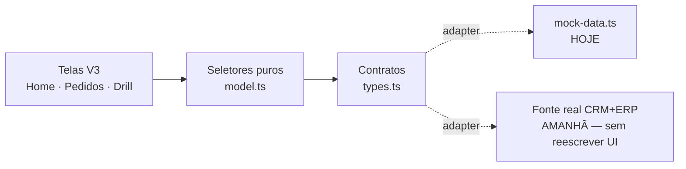

# Próximo incremento da Central de Receita — escopo travado em grill (29/09/2026)

> Fonte: grill rodadas 1 e 2 com Bruno + análise dos prints do Hunter OS + ask-matt.
> Este documento é o insumo para debate (Astra) e para spec/tickets do incremento.

## 1. Contexto

- V3 "Pulso Comercial" implementada e rodando **local** (`http://127.0.0.1:3001`), merge na `main` (commit `38ca939`). Railway descartado por enquanto ("sobe somente local, deixa ai isso").
- **Camadas de produto (decisão):** Hunter OS (`hunter-estrategico.vercel.app`) é a ferramenta do **coordenador** (detalhe). A Central é o **pulso do Giovane/diretor**; o drill down da Central desce até o nível de detalhe que hoje só o coordenador vê — subtela até a origem e volta.
- Público: Giovane (head de vendas). Mocks SEM dados reais ainda; mobile em segundo momento; design continua evoluindo.

## 2. Blocos do incremento (escolhas do Bruno: "c e d")

### Bloco A — Visão de Pedidos (fila de integração)
Não é "lista de pedidos": é **R$ em risco de deslizar, com relógio**.
- Pipeline de estados: `na fila → subiu pra conferência → conferido | devolvido` (devolvido corrigido volta pra conferência).
- Deadline: **último dia do mês**. Não integrou → receita reconhecida **no mês seguinte**; no fim de trimestre, desliza o **trimestre inteiro**.
- Cada pedido: valor, conta, filial, executivo dono, NN/Cross, tempo na fila, dias até o deadline, estado do pipeline.
- Funil de R$ por estado + total em risco pendurado sobre o forecast do mês.

### Bloco B — Drill-down estratégico até a origem, com volta
- Uma tela única que desce: pulso → recorte (filial/solução/executivo) → pedido/oportunidade → **origem** (subtela) → volta à tela inicial.
- Nível de detalhe = vocabulário do coordenador (Hunter OS).

### Bloco C — Agente Comercial real (não só briefing)
- De manhã o agente aponta ação: **pedidos devolvidos → cobrar o executivo dono** (valor + relógio na mesa).
- Próximo passo de agência depois: ação proativa além do report.

## 3. ADRs travadas no grill

| # | Decisão | Regra |
|---|---------|-------|
| ADR-1 | Assinado ≠ ganho | Só **integração** conta como realizado; assinado na fila não vale para o número do executivo |
| ADR-2 | Reconhecimento | Não integrou até o último dia do mês → mês seguinte; fim de tri → outro trimestre |
| ADR-3 | Devolvido → executivo | A conferência devolve para o executivo que assinou; ele "fica em cima"; motivo = campo livre (taxonomia real não informada) |
| ADR-4 | NN/Cross deriva do grupo econômico | Origin não é campo cadastrado; é derivado do grupo econômico da conta (detalhe pendente: frase cortada "mas não…") |
| ADR-5 | Central ≠ Hunter | Central é porta de entrada que DESCE ao detalhe; não substitui o Hunter |

## 4. Vocabulário operacional a espelhar (extraído do Hunter OS)

- Colunas forecast: OPORTUNIDADE · CONTA · NN · EXECUTIVO · FILIAL · RECORRÊNCIA · NÃO RECORR. · PROB. (%) · VALOR ESPERADO · CONGELADA (S/N) · STATUS (ATUAL/POSTERGADA).
- Congelamento: Comprometido · Decididas · Ass. Conta · Valor Congelado · Valor Ganho.
- Funil: PRIMEIRO CONTATO → MAPEAMENTO → DEFESA TÉCNICA → PROPOSTA → NEGOCIAÇÃO → SEM ETAPA.
- Filiais reais: DF, MS, MT, JP, PR, SC, RS, PANTANAL. Filtro "Apenas New Name"; LÍDER dependente de FILIAL.
- Gap do Hunter (nosso bloco novo): pedidos na fila de integração.

## 5. Arquitetura (conselho ask-matt: deep module + seam)

- Contratos novos em `types.ts`: `Order` (pedido), `OrderPipelineState`, `IntegrationDeadline`, `EconomicGroup` na conta.
- Seletores novos puros e testados (`node --test`), mesmo padrão dos 61 existentes.
- Execução em tickets tracer-bullet com blockers primeiro (fluxo ask-matt: to-spec → to-tickets → implement/TDD).

### Bloco D — Experiência de ponta (transversal)
- Gráficos interativos ao toque: hover/touch por ponto com **tooltip que explica o número referenciado** (não só valor; liga série ↔ card KPI).
- Polimento visual: contraste dos eixos, densidade, microtransições 180-280ms.

## 6. Abertos (para o debate / próxima rodada)

1. Fecho da frase "mas não…" (ADR-4) — o que exatamente o grupo econômico não é.
2. "Ir até a origem": origem = oportunidade no CRM? pedido no ERP? os dois (rastro assinatura → pedido → integração)?
3. Taxonomia real de motivos de devolução (hoje: campo livre).
4. Agente Bloco C: até onde vai a proatividade no primeiro corte (só aponta, ou já rascunha cobrança/mensagem)?
5. Período do relógio: mês corrente sempre, ou o quarter também entra como lente na Visão de Pedidos?
