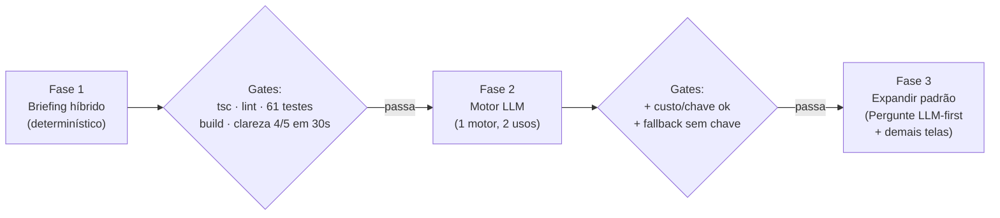

# Plano v2 — Briefing híbrido (trilha + agente) e Pergunte LLM-first

**Fechado por:** agente principal (GLM-5.3) em 28/09/2026, a partir do grill com Bruno, do inventário técnico (`docs/design/harness-inventario-2026-09-28.md`), da referência de dor real (`docs/design/referencia-crm-head-vendas.md`) e dos mocks A/B (`docs/design/piloto/`).
**Modo de execução:** Ponytail ativo (menor diff que funciona; reuso antes de criar; `ponytail:` em corte com teto conhecido). Harness: GLM-5.3-Flash no trabalho bruto, GLM-5.3 fecha código e decisão.

## 1. Decisões do Bruno (grill de 28/09 — todas DECISÃO DO USUÁRIO)

| # | Decisão |
|---|---|
| D1 | IA no piloto: **híbrido** — números e propostas 100% determinísticos; IA só na linguagem (explicar variação, redigir follow-up) |
| D2 | **Pergunte à Receita: LLM-first** (conversacional real) |
| D3 | Layout do Briefing: **híbrido — trilha de execução + agente acoplado ao item** |
| D4 | Sequência: **Briefing híbrido primeiro; Pergunte LLM na sequência** |
| D5 | Execução com **Ponytail** |

## 2. Produto alvo em uma frase

O Briefing abre respondendo **quanto está em jogo, o que vence, quem responde e o que fazer agora** — trilha de desbloqueios ordenada por valor, cada item com ação e agente no contexto — e o Pergunte à Receita vira conversa real com IA que formula sobre números determinísticos.

**Fonte primeira:** dor real do head de vendas (PDF 43 pág.): valor + data prevista + responsável na primeira camada; cor por regra; painel de follow-up como superfície de primeira classe; densidade com hierarquia, não corte.

## 3. Fluxo de entrega

## 4. Fase 1 — Briefing híbrido (determinístico)

**Escopo:** primeira camada da tela `agora` (Briefing). Seções inferiores e demais telas ficam até o padrão ser aprovado.

**Menor diff mapeado (inventário §2):**

| Alvo | Ação | Por quê |
|---|---|---|
| `agora.tsx` | Transformar: headers discursivos e `
` de regra saem da primeira camada; trilha lateral nova | É onde o "texto demais" se concentra (agora.tsx:288-296, 204-211) |
| `briefing-visuais.tsx` | **Reusar** painéis dado→visual; texto de limitação vira proveniência sob demanda | Já faz o trabalho visual (briefing-visuais.tsx:39-618) |
| Trilha lateral nova | "Desbloquear agora" por valor: itens do **Radar R1–R7** (previsão vencida, sem ação 21/45d, slip >60d…) + fila da agenda `/api/agora` | Dados já existem — `/api/radar` e `/api/agora`; **zero endpoint novo** |
| Agente acoplado | Reusar `Agente` modo `painel` dentro do item expandido da trilha (mesma técnica do Sheet em assistant-trigger.tsx:46) | Núcleo agênico já existe (agente.tsx:47) |
| IA linguagem (D1) | Fase 1 usa texto determinístico curto (causas de `/api/mudancas` + regras do radar). O motor LLM entra na Fase 2 e serve os DOIS usos | 1 motor, 2 consumidores — não construir LLM antes da fase 2 |

**Regras Ponytail da fase:** sem endpoint novo; sem lib nova; sem estado global novo (ContextoGlobal fica); `
`/`<dialog>` nativos; DTOs, `IrPara`, `useApi` e URLs intocados. Selo "simulação · nada foi salvo" em toda ação.

**Telas de referência:** mock híbrido = `docs/design/piloto/piloto-b-trilha-execucao.html` com a resposta do agente do `piloto-a-painel-agente.html` dentro do item expandido.

## 5. Fase 2 — Motor LLM (1 motor, 2 usos)

- **Uso 1 (D2):** Pergunte à Receita LLM-first — `POST /api/agente` mantém contrato `{pergunta, contexto}`; motor troca de determinístico para LLM **sobre o snapshot filtrado**; números sempre do domínio, LLM só formula (proibição de inventar valor continua: prompt recebe dados, não liberdade).
- **Uso 2 (D1):** explicações da trilha ("explicar variação", redigir follow-up) pelo mesmo motor, com os mesmos dados do item.
- **Provedor:** GLM via conta Z.AI, chave em `.env.local` (nunca em código/log). Custo por pergunta registrado no worklog quando medido.
- **Fallback determinístico:** sem chave ou erro de rede → resposta por regras atuais, com selo claro "modo offline por regras". Erro visível, nunca silencioso.
- **Validação:** respostas LLM conferidas contra gabarito do fixture (zero tolerância para valor/período errado) — reuse dos testes existentes + casos novos de formulação.

## 6. Critérios de aceite (herdados e mantidos)

1. **Clareza:** leitor responde ≥4 de 5 perguntas em ≤30s na primeira viewport (valor principal, período, comparação, maior concentração, como aprofundar/pedir explicação).
2. **Prosa:** −50% de palavras auxiliares na primeira viewport vs. atual, **medido** (contagem antes/depois, mesmo viewport/estado) — meta do plano de 28/09 ainda não executada.
3. **Integridade:** nenhum valor cortado; zero real ≠ indisponível; meta/atingimento só com fonte; PEX ≠ projeção ≠ receita reconhecida (semântica do inventário §4).
4. **Técnico:** `npx tsc --noEmit`, `npx eslint .`, 61 testes com `CENTRAL_BASE_URL=http://127.0.0.1:3001`, `next build` (após parar dev), smoke `/api/meta` HTTP 200.
5. **Acessibilidade:** teclado/foco visível, detalhe por clique (nunca só hover), cor nunca única, 1440×900 e 390×844 sem overflow.
6. **Git:** branch `main` sem commit/reset/limpeza; 171 exclusões staged preservadas.

## 7. Harness de execução (D5 + diretriz flash/5.3)

| Trabalho | Quem |
|---|---|
| Leitura de arquivos, conferência de valores contra API, inventários de mudança, primeira triagem de QA | **GLM-5.3-Flash** (workflow com frentes de escopo fechado, 600 palavras, arquivo:linha) |
| Diff de código, decisões de design, fechamento de fase, revisão final | **GLM-5.3** (principal) |
| Inspeção de imagem (prints, capturas, PDF) | **Principal** (flash não lê imagem confiável) |
| Implementação | Principal ou implementer com **Ponytail ativo** |

Fases do workflow de execução: mapear diff exato → implementar em lote único (fase 1 cabe num lote) → QA bruto no flash (conferir valores, capturas) → revisão e gates no principal → leitura com Bruno.

## 8. Riscos e limites conhecidos

- **LLM formular errado** (fase 2): mitigado por gabarito + números sempre do domínio + selo de modo.
- **Custo LLM** (fase 2): sem medidor no plano gratuito — registrar consumo quando existir; NÃO VERIFICADO até lá.
- **Densidade × clareza:** a dor real pede densidade; o gate de 30s protege o limite.
- **Conflitos abertos do inventário** (§5 do inventário — 10×12 rotas, versão 0.2.1 × v1.1.0-mock, status da direção 25/09): não bloqueiam fase 1; resolver na primeira retomada de QA.

## 9. O que NÃO fazer

- Não reescrever tela do zero; não criar design system novo; não tocar `node_modules`; não commit/reset; sem CRM/writeback/auth nesta fase; sem LLM em produção de número — IA formula, domínio calcula.

## 10. Adendo (28/09 tarde) — o que o acervo essencial muda no plano

**Fonte:** `docs/design/acervo-copilot-sintese.md` (3 frentes Flash + crítica independente; enquadramento: a Central é UMA FRENTE da estrutura RevOps que Bruno está montando — a planta baixa é o mapa).

1. **Trilha "exige você" ganha itens reais de negócio, não só sinais de dados** (§4 da síntese): LAC-01 (Pedido/ERP→Serviços — validar antes), LAC-02 (New Name→Base — alinhamento de autoridade) e as 6 decisões a congelar do Ciclo 1 (D01/D02/D03/D08/D11/proposta válida), com fórum designado (Semanal Inteligência de Vendas, sexta 10h). Convergência de duas fontes independentes (PPTX s.27 + AP07 p.10) valida LAC-01/02 como prioridade.
2. **Padrão de procedência em 3 níveis do Scout 360** (verde=pesquisado · dourado=anexo · azul=informado, v10) aplica-se a todo número da Central — evoluir o `ProvenienciaInline` existente quando a tela for aprovada.
3. **Gramática de agente validada pelo dossiê:** "CRM → regra oficial → indicador → decisão → agente — não o inverso" (PDF p.1) e "NÃO SAIR AUTOMATIZANDO" (PPTX s.29). A Fase 2 (LLM) segue exatamente essa ordem — lastro estratégico para D1/D2 do grill.
4. **Guarda permanente:** a Central é "acelerador do Ciclo 1, não fonte canônica da regra oficial de Win" (Ciclo 1 p.8); Wins sem status de pedido não são canônicos (p.9); snapshot local ≠ recorte oficial por presunção (p.8). Nenhuma tela da Central se apresenta como fonte da regra.
5. **Norte da frente:** a planta admite que "a visão ponta a ponta precisa ser construída" (PPTX s.4) e pede "cadeia de receita observável" (s.26) — a Central é candidata natural (INFERÊNCIA da síntese, não decisão).
6. **Pendência:** sequência dos 4 pilotos do §4 da síntese não foi decidida — nenhuma implementação nova antes da leitura ao vivo da Fase 1.5 e da escolha de ordem.
